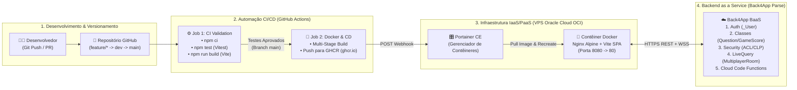
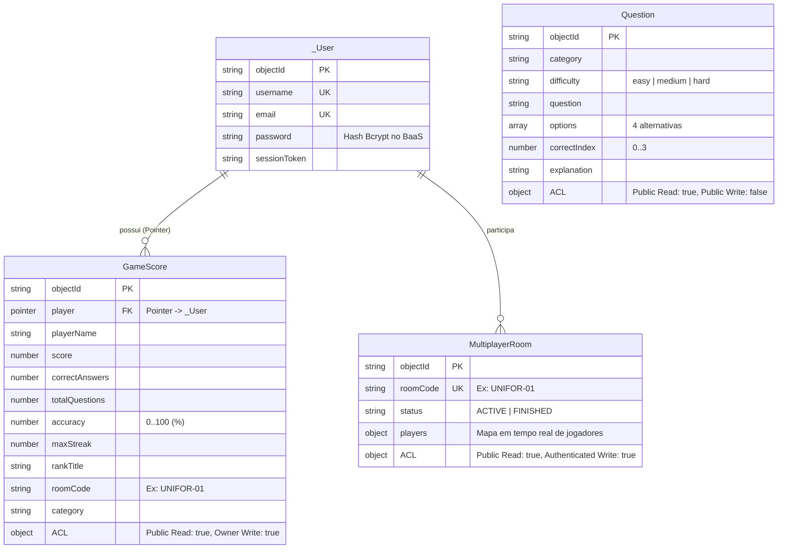

# UNIVERSIDADE DE FORTALEZA (UNIFOR)
## CENTRO DE CIÊNCIAS TECNOLÓGICAS (CCT) — CIÊNCIA DA COMPUTAÇÃO
### DISCIPLINA: DESENVOLVIMENTO DE SOFTWARE EM NUVEM

---

# Trabalho Final: Cloud-Powered Mini-Games com Docker e BaaS
## Projeto: **CloudQuiz Arena (Multiplayer Sincronizado)**

**Integrantes da Equipe (Preencher nomes e matrículas):**
- **Gerente de Projeto:** `[Nome do Aluno 1 — Matrícula]`
- **Desenvolvedor Frontend:** `[Nome do Aluno 2 — Matrícula]`
- **DevOps & Cloud Engineer:** `[Nome do Aluno 3 — Matrícula]`
- **Desenvolvedor Backend / BaaS:** `[Nome do Aluno 4 — Matrícula]`

---

# PARTE I — ENTREGA 1: PLANO DE TRABALHO E ARQUITETURA DA SOLUÇÃO (2,0 PONTOS)

## 2.1. Introdução e Justificativa Tecnológica

O projeto **CloudQuiz Arena** consiste em um mini-game web interativo de perguntas e respostas com suporte a partidas **Multiplayer Sincronizadas** e **Ranking Global em Tempo Real**, cuja temática aborda os próprios conceitos de Computação em Nuvem (IaaS, PaaS, BaaS, Docker, Portainer e CI/CD).

A arquitetura da solução foi desenhada para combinar alta produtividade de desenvolvimento, padronização operacional e entrega contínua automatizada, estruturando-se sobre três pilares tecnológicos:

### 1. Agilidade na Camada de Dados com Ecossistema BaaS (Back4App / Parse Platform)
A adoção do **Back4App** como *Backend as a Service (BaaS)* elimina a necessidade de codificar, provisionar e manter um servidor backend monolítico do zero para operações recorrentes. No **CloudQuiz Arena**, integramos **cinco (5) recursos nativos** da plataforma (superando o requisito mínimo de 4 funcionalidades):
1. **Autenticação e Gestão de Sessão (`_User` / Parse Auth):** Fluxo completo de registro (`POST /users`), login (`GET /login`), validação de sessão via cabeçalho `X-Parse-Session-Token` e encerramento seguro (`POST /logout`).
2. **Persistência NoSQL/Relacional em Classes (`Question`, `GameScore`, `MultiplayerRoom`):** Armazenamento estruturado das questões do quiz, histórico de pontuações com chave estrangeira relacional (`Pointer` para `_User`) e estado das salas multiplayer.
3. **Segurança Granular via ACLs (Access Control Lists) e CLPs (Class-Level Permissions):** Cada pontuação salva no banco recebe uma política `ACL` ao nível do documento (`{"*": {"read": true}, "<userId>": {"read": true, "write": true}}`), permitindo que todos os jogadores consultem o Ranking Global (leitura pública), mas garantindo que apenas o próprio autor autenticado possa criar ou atualizar seu registro.
4. **Sincronização em Tempo Real (`Parse LiveQuery` WebSockets & Real-Time Rooms):** Atualização instantânea do avanço dos jogadores dentro de uma sala (`MultiplayerRoom`) e atualização automática do placar (`GameScore`) sem necessidade de recarregar a página.
5. **Cloud Code Functions (`/functions/validateAndSaveScore`):** Execução de lógica *serverless* diretamente na nuvem do Back4App (`cloud/main.js`) para validação *anti-cheat* do teto matemático de pontos antes da persistência definitiva.

### 2. Portabilidade e Padronização do Ambiente via Vite + Docker na Oracle Cloud (OCI)
O frontend foi construído com **React 18 + Vite**, proporcionando *Hot Module Replacement (HMR)* instantâneo durante o desenvolvimento e *bundles* estáticos altamente otimizados em produção (`npm run build`). Para garantir paridade total entre os ambientes de desenvolvimento, teste e produção (eliminando o problema de *"funciona na minha máquina"*), a aplicação é empacotada por meio de um **Dockerfile Multi-Stage**:
- **Estágio 1 (`builder` — `node:20-alpine`):** Instala dependências de forma determinística (`npm ci`) e compila os artefatos otimizados na pasta `/app/dist`.
- **Estágio 2 (`production` — `nginx:stable-alpine`):** Copia exclusivamente os estáticos compilados para uma imagem enxuta do servidor Nginx (~25 MB), com compressão Gzip, roteamento SPA e endpoint de monitoramento `/healthz`, hospedada em uma **VPS Linux na Oracle Cloud Infrastructure (OCI - IaaS)** e orquestrada visualmente via **Portainer**.

### 3. Garantia de Qualidade do Código e Entrega Contínua com GitHub Actions
Para assegurar que nenhuma alteração introduza regressões nas regras do jogo ou quebre a compilação, foi implementado um pipeline de **Integração e Entrega Contínua (CI/CD)** no **GitHub Actions** (`.github/workflows/ci-cd.yml`). A cada `push` ou `pull_request`:
1. O código é submetido a uma bateria de **Testes Funcionais Automatizados com Vitest** (`npm test`), que validam matematicamente o cálculo de pontuação, bônus de tempo, multiplicador de *streak*, regras de vitória multiplayer e formatação de segurança `ACL` do payload enviado ao BaaS.
2. A compilação de produção do Vite (`npm run build`) é verificada.
3. Na branch `main`, uma nova imagem Docker é construída, publicada no **GitHub Container Registry (`ghcr.io`)** e o **Webhook do Portainer** na VPS Oracle Cloud é acionado automaticamente para atualizar o contêiner em produção sem intervenção manual (*Zero-Downtime Redeploy*).

---

## 2.2. Formação do Grupo e Divisão de Papéis

A organização do trabalho segue metodologias ágeis utilizando o **GitHub Projects** (quadro Kanban com colunas *Backlog*, *In Progress*, *Code Review / CI* e *Done in OCI*), com a seguinte atribuição de responsabilidades:

| Papel na Equipe | Responsável | Responsabilidades Principais e Entregáveis |
| :--- | :--- | :--- |
| **Gerente de Projeto** | `[Aluno 1]` | • Criação e acompanhamento do quadro Kanban no GitHub Projects.<br>• Gestão do cronograma das Entregas 1 e 2.<br>• Revisão da documentação arquitetural, requisitos e condução da apresentação prática. |
| **Desenvolvedor Frontend** | `[Aluno 2]` | • Estruturação do projeto React + Vite (`src/App.jsx`, `src/styles.css`).<br>• Implementação das telas de Autenticação, Lobby Multiplayer, Arena do Quiz com cronômetro e Ranking.<br>• Implementação das regras de negócio puras (`src/utils/gameRules.js`) e testes no Vitest. |
| **DevOps & Cloud Engineer** | `[Aluno 3]` | • Provisionamento da instância VPS Linux na Oracle Cloud (OCI) e liberação de Security Lists (portas 80, 443, 8080, 9443).<br>• Instalação do Docker e Portainer na VPS.<br>• Criação do `Dockerfile` multi-stage, `nginx.conf`, `docker-compose.yml` e pipeline `.github/workflows/ci-cd.yml`. |
| **Desenvolvedor Backend / BaaS** | `[Aluno 4]` | • Criação e modelagem das classes `_User`, `Question`, `GameScore` e `MultiplayerRoom` no painel do Back4App.<br>• Configuração de segurança CLP/ACL e publicação da Cloud Function `cloud/main.js`.<br>• Desenvolvimento do módulo cliente BaaS (`src/services/back4app.js`) com suporte a LiveQuery. |

---

## 2.3. Tema e Escopo do Projeto

- **Modelo Escolhido:** **CloudQuiz (Multiplayer Sincronizado)** — Jogo de perguntas e respostas com salas multiplayer em tempo real e ranking de jogadores sincronizado via BaaS.
- **Mecânica e Regras Principais do Jogo:**
  1. **Partidas por Sala ou Global:** O jogador autenticado escolhe uma sala sincronizada (ex: `UNIFOR-01`, `OCI-PROD`, `GLOBAL`). Todos os jogadores na mesma sala têm seu progresso (questão atual e pontuação) sincronizado ao vivo na tela.
  2. **Cálculo Dinâmico de Pontuação:** Cada questão possui um tempo limite de **20 segundos** e uma dificuldade (`easy` = 100 pts, `medium` = 150 pts, `hard` = 200 pts). Ao acertar:
     $$\text{Pontos da Questão} = \text{Pontos Base} + (\text{Segundos Restantes} \times 5) + \text{Bônus de Streak}$$
     Onde o **Bônus de Streak** adiciona $+25\text{ pts}$ por acerto consecutivo a partir do 2º acerto seguido (limitado a $+125\text{ pts}$ por questão).
  3. **Regra de Vitória e Patentes Cloud:** No modo Solo, o jogador vence ao atingir precisão $\ge 60\%$ e pontuação $\ge 500\text{ pts}$. No modo Multiplayer Sincronizado, vence quem obtiver a maior pontuação ao final da rodada na sala, recebendo uma patente técnica (*Cloud Trainee*, *Junior Cloud Developer*, *Cloud Engineer*, *DevOps & SRE Lead* ou *Principal Cloud Architect*).

---

## 2.4. Arquitetura da Solução, CI/CD e Versionamento

### 2.4.1. Fluxo Esquemático Completo
```text
[Desenvolvedor] -> [GitHub Push/PR] -> [GitHub Actions (Build & Testes Funcionais)] -> [Webhook / Portainer na VPS Oracle Cloud] -> [Aplicação no Ar (Vite)] <-> [Plataforma BaaS (Back4App)]
```

### 2.4.2. Diagrama de Arquitetura e Pipeline CI/CD



### 2.4.3. Estratégia de Branching (Git Flow Simplificado)
O versionamento no Git segue três níveis de branches para garantir estabilidade em produção:
- **`main` (Produção):** Branch protegida que reflete o código em execução na VPS da Oracle Cloud. Aceita código exclusivamente via *Pull Request* originado da `dev` após aprovação obrigatória da pipeline do GitHub Actions (Build + Testes Funcionais Vitest). Todo merge na `main` dispara automaticamente o build da imagem Docker e o Webhook de redeploy no Portainer.
- **`dev` (Integração / Homologação):** Branch de integração contínua da equipe. Nela os recursos desenvolvidos pelos membros são integrados e validados pela etapa de CI (`validate-and-test`) sem acionar deploy em produção.
- **`feature/*` e `fix/*` (Desenvolvimento):** Branches de curta duração criadas a partir de `dev` para cada funcionalidade ou correção (ex: `feature/auth-back4app`, `feature/multiplayer-sync`, `feature/dockerfile-nginx`, `feature/vitest-rules`).

---

## 2.5. Requisitos e Modelagem

### 2.5.1. Requisitos Funcionais (RF)

| Código | Requisito Funcional | Descrição |
| :--- | :--- | :--- |
| **RF01** | **Autenticação de Jogadores no BaaS** | O sistema deve permitir o cadastro (*Sign Up*), autenticação (*Login*) e encerramento de sessão (*Logout*) de jogadores integrando-se à classe nativa `_User` do Back4App. |
| **RF02** | **Carregamento Dinâmico de Questões** | O sistema deve consultar a classe `Question` no Back4App para carregar os enunciados, alternativas, nível de dificuldade e explicação técnica de cada rodada do quiz. |
| **RF03** | **Cálculo de Pontuação com Tempo e Streak** | O sistema deve contabilizar um cronômetro regressivo de 20 segundos por questão e calcular a pontuação somando os pontos base da dificuldade, o bônus de tempo restante ($5\text{ pts/s}$) e o bônus de sequência de acertos (*streak*). |
| **RF04** | **Salas Multiplayer Sincronizadas em Tempo Real** | O sistema deve permitir que múltiplos jogadores entrem em uma mesma sala (classe `MultiplayerRoom`) e visualizem o placar e a questão atual dos adversários sincronizados em tempo real via *LiveQuery* / eventos BaaS. |
| **RF05** | **Persistência Segura de Pontuação e Ranking** | Ao término da partida, o sistema deve persistir o resultado na classe `GameScore` (via Cloud Code Function / REST API) associando um `Pointer` ao jogador autenticado e aplicando regras `ACL` de leitura pública e escrita restrita ao dono. |
| **RF06** | **Painel de Ranking Global e por Sala** | O sistema deve exibir o ranking ordenado decrescentemente por pontuação (`order=-score,-accuracy`), permitindo filtrar entre o placar Global e o placar específico da sala multiplayer ativa. |

### 2.5.2. Requisitos Não-Funcionais (RNF)

| Código | Requisito Não-Funcional | Categoria | Especificação Técnica |
| :--- | :--- | :--- | :--- |
| **RNF01** | **Conteinerização Leve e Portável** | Infraestrutura / Docker | A aplicação frontend deve ser empacotada em imagem Docker *Multi-Stage* baseada em `nginx:stable-alpine`, resultando em imagem final inferior a 50 MB e tempo de inicialização menor que 3 segundos. |
| **RNF02** | **Segurança de Dados no BaaS (ACL/CLP)** | Segurança | Nenhuma chave administrativa (*Master Key*) deve ser exposta no frontend; todas as escritas na classe `GameScore` devem exigir token de sessão válido (`X-Parse-Session-Token`) e aplicar `ACL` impedindo edição por terceiros. |
| **RNF03** | **Automação de Testes e Build (CI)** | Qualidade / CI | Todo *Push* ou *Pull Request* no GitHub deve executar automaticamente os testes funcionais no **Vitest** e validar o `npm run build` em menos de 2 minutos. |
| **RNF04** | **Entrega Contínua Automatizada (CD)** | DevOps / Deploy | A aprovação de código na branch `main` deve atualizar automaticamente o contêiner na VPS Oracle Cloud via Webhook do Portainer sem necessidade de intervenção manual via SSH. |
| **RNF05** | **Monitoramento de Saúde do Contêiner** | Disponibilidade | O servidor Nginx do contêiner deve responder na rota `/healthz` com status HTTP 200 para verificação automática de integridade (`HEALTHCHECK`) no Portainer. |
| **RNF06** | **Responsividade e Baixa Latência de UI** | Usabilidade | A interface construída em React + Vite deve ser responsiva para desktops e dispositivos móveis, com tempo de carregamento inicial (*First Contentful Paint*) inferior a 1,5 segundo. |

---

### 2.5.3. Estrutura do Banco de Dados no BaaS (Back4App)

O modelo de dados no **Back4App (Parse Server)** é composto por 4 classes principais:



#### Matriz de Segurança das Classes no Painel do Back4App (CLP & ACL):

| Classe no Back4App | CLP (Class-Level Permissions) | ACL por Objeto (Access Control List) |
| :--- | :--- | :--- |
| **`_User`** | `Find: Authenticated`, `Create: Public (SignUp)`, `Update/Delete: Owner` | Leitura pública do `username`; escrita exclusiva do próprio usuário. |
| **`Question`** | `Find/Get: Public`, `Create/Update/Delete: Authenticated / Admin` | `{"*": {"read": true}}` (Todos leem as questões durante o quiz). |
| **`GameScore`** | `Find/Get: Public`, `Create: Authenticated`, `Update/Delete: Owner` | `{"*": {"read": true}, "<userId>": {"read": true, "write": true}}`. |
| **`MultiplayerRoom`** | `Find/Get: Public`, `Create/Update: Authenticated` | Sincronização habilitada no **Parse LiveQuery Server**. |

---

### 2.5.4. Protótipos da Interface (Wireframes Conceituais das Telas do Jogo)

#### Tela 1: Autenticação BaaS (`_User` — Login e Registro) e Telemetria
```text
+-----------------------------------------------------------------------------------+
| [☁️ CloudQuiz Arena v1.0 • Vite + Docker OCI]  [🟢 Back4App Cloud] [⚙️ Config BaaS]|
+--------------------------------------------------+--------------------------------+
| 🔐 AUTENTICAÇÃO DE JOGADOR NO BaaS (_User)       | 🏆 RANKING BaaS (GameScore)    |
| [ Entrar (Login) ]  [ Criar Conta (Sign Up) ]    | [Global] [Sala UNIFOR-01]      |
|                                                  | 🥇 AnaClara_Cloud    1320 pts  |
| Nome de Usuário: [ Gabriel_Cloud              ]  | 🥈 Lucas_DevOps      1090 pts  |
| E-mail:          [ gabriel@edu.unifor.br      ]  | 🥉 Mariana_OCI        880 pts  |
| Senha:           [ ••••••••••••               ]  +--------------------------------+
|                                                  | 📡 TELEMETRIA BaaS (AO VIVO)   |
| [     Autenticar e Entrar no Lobby     ]         | • 1. Auth: POST /users OK      |
| [⚡ Demo Jogador 1]  [⚡ Demo Jogador 2]          | • 2. DB: GET /classes/GameScore|
+--------------------------------------------------+--------------------------------+
```

#### Tela 2: Lobby Multiplayer Sincronizado (`MultiplayerRoom` + `LiveQuery`)
```text
+--------------------------------------------------+--------------------------------+
| 🎮 LOBBY MULTIPLAYER SINCRONIZADO (Olá, Gabriel) | 🏆 RANKING BaaS (GameScore)    |
|                                                  | 🥇 AnaClara_Cloud    1320 pts  |
| Código da Sala Multiplayer:                      | 🥈 Lucas_DevOps      1090 pts  |
| [ UNIFOR-01          ] [🚀 Iniciar CloudQuiz]    | 🥉 Mariana_OCI        880 pts  |
|                                                  +--------------------------------+
| Salas Rápidas: [UNIFOR-01] [OCI-PROD] [GLOBAL]   | 📡 TELEMETRIA BaaS (AO VIVO)   |
|                                                  | • 4. LiveQuery: Subscribed to  |
| 📡 Estado em Tempo Real da Sala [UNIFOR-01]:     |   MultiplayerRoom [UNIFOR-01]  |
| • Gabriel_Cloud  • Questão 1 (PLAYING) —   0 pts | • 1. Auth: Login Session Ativa |
| • Lucas_DevOps   • Questão 3 (PLAYING) — 540 pts |                                |
+--------------------------------------------------+--------------------------------+
```

#### Tela 3: Arena do Quiz em Tempo Real (Timer, Streak e Feedback Explicativo)
```text
+-----------------------------------------------------------------------------------+
| ⚡ Sala [UNIFOR-01] — Questão 2 de 6                  [Docker & Conteinerização]  |
+-------------------+-------------------+-------------------+-----------------------+
|   TEMPO: 16s      |  PONTUAÇÃO: 245   |   STREAK 🔥: 2x   |  DIFICULDADE: MEDIUM  |
+-------------------+-------------------+-------------------+-----------------------+
| Tópico: Docker & Conteinerização                                  Base: 150 pts   |
| Qual é a principal vantagem de utilizar Multi-Stage Build no Dockerfile de uma    |
| aplicação Vite/React em produção?                                                 |
|                                                                                   |
| [A] Executar o código React diretamente no kernel do Linux sem navegador          |
| [B] Compilar no estágio Node.js e servir apenas a pasta dist/ em Nginx Alpine ✅  |
| [C] Incluir node_modules na imagem final para acelerar o container                |
| [D] Substituir a necessidade de um servidor web HTTP na porta 80                  |
|                                                                                   |
| ✅ Resposta Correta!  +255 pts (150 base + 80 tempo + 25 streak)                  |
| [                  Próxima Questão →                                           ]  |
+-----------------------------------------------------------------------------------+
```

#### Tela 4: Resultado Final, Patente Cloud e Auditoria de Payload ACL
```text
+-----------------------------------------------------------------------------------+
| 🏆 Resultado Final — Principal Cloud Architect             [APROVADO / VITÓRIA]   |
+-------------------+-------------------+-------------------+-----------------------+
| SCORE FINAL: 1410 |  PRECISÃO: 100%   |   ACERTOS: 6/6    |   MAIOR STREAK: 6x    |
+-------------------+-------------------+-------------------+-----------------------+
| 🔒 Payload Persistido no Back4App com ACL e Pointer Relacional (Recurso #3):      |
| {                                                                                 |
|   "playerName": "Gabriel_Cloud", "score": 1410, "accuracy": 100,                  |
|   "player": { "__type": "Pointer", "className": "_User", "objectId": "usr_12" },  |
|   "ACL": { "*": { "read": true }, "usr_12": { "read": true, "write": true } }     |
| }                                                                                 |
| [🔄 Jogar Novamente na Sala UNIFOR-01]   [🏠 Voltar ao Lobby]                     |
+-----------------------------------------------------------------------------------+
```

---

# PARTE II — ENTREGA 2: RELATÓRIO TÉCNICO FINAL, AUTOMAÇÃO CI/CD E GUIA DE DEPLOY (4,0 PONTOS)

## 3.1. Configuração do Backend no Back4App (BaaS)

Siga este passo a passo rápido para configurar sua conta no **Back4App** (ou utilize o botão **🌱 Popular Classe Question no Back4App** diretamente na interface do jogo):

1. Acesse [https://www.back4app.com/](https://www.back4app.com/), crie um novo aplicativo chamado **`cloudquiz-unifor`**.
2. No menu lateral do Back4App, vá em **App Settings → Security & Keys** e copie:
   - **`Application ID`** (`VITE_BACK4APP_APP_ID`)
   - **`JavaScript Key`** (`VITE_BACK4APP_JS_KEY`)
3. **(Opcional — LiveQuery em Tempo Real):** Vá em **App Settings → Server Settings → LiveQuery → Settings**, marque **Activate LiveQuery** e marque as classes `MultiplayerRoom` e `GameScore`. O subdomínio gerado será `wss://SEU_SUBDOMINIO.b4a.io` (`VITE_BACK4APP_LIVEQUERY_URL`).
4. **(Opcional — Cloud Code Function):** No menu lateral, vá em **Cloud Code → Functions & Web Hosting**, abra o arquivo `cloud/main.js`, cole o conteúdo do arquivo [`cloud/main.js`](../cloud/main.js) deste repositório e clique em **Deploy**.
5. **Criação Automática das Classes e Questões:**
   - Abra o jogo, clique em **⚙️ Configurar Back4App** no topo da tela, cole o `Application ID` e a `JavaScript Key`, salve e clique no botão **🌱 Popular Classe Question no Back4App**. O sistema criará automaticamente a classe `Question` com todas as perguntas e permissões `ACL`!

---

## 3.2. Decisões de Conteinerização (Vite + Docker Multi-Stage)

O arquivo [`Dockerfile`](../Dockerfile) foi construído utilizando a técnica de **Multi-Stage Build**:
- **Por que Multi-Stage Build?** Uma imagem Node.js contendo o código-fonte e a pasta `node_modules` ocupa cerca de **450 MB a 900 MB** e expõe ferramentas de build desnecessárias em produção. Com o Multi-Stage Build, o estágio `builder` (`node:20-alpine`) executa `npm ci` e `npm run build`, gerando apenas os arquivos estáticos minificados em `/app/dist`. Em seguida, o estágio `production` (`nginx:stable-alpine`) copia apenas `/app/dist` e aplica o arquivo [`nginx.conf`](../nginx.conf), gerando uma imagem final de **~25 MB**, imutável, segura e com suporte nativo a `HEALTHCHECK` na rota `/healthz`.

---

## 3.3. Pipeline CI/CD no GitHub Actions e Testes Funcionais (Vitest)

O arquivo [`.github/workflows/ci-cd.yml`](../.github/workflows/ci-cd.yml) automatiza todo o ciclo de vida da aplicação em 2 Jobs encadeados:

1. **Job 1 (`validate-and-test`):**
   - Executa em todo `push` e `pull_request` para `main` e `dev`.
   - Roda `npm ci` para instalar versões exatas do `package-lock.json`.
   - Roda **`npm test` (Vitest)**, executando os 6 testes funcionais automatizados em [`src/utils/__tests__/gameRules.test.js`](../src/utils/__tests__/gameRules.test.js) que validam:
     - Regra de resposta incorreta (zera pontos e *streak*);
     - Cálculo de pontos base + bônus de tempo ($5\text{ pts/s}$);
     - Acúmulo e teto máximo do multiplicador de sequência (*streak*);
     - Regra de aprovação/vitória no modo Solo e desempate no modo Multiplayer Sincronizado;
     - Formatação do payload do Back4App com `Pointer` para `_User` e segurança `ACL`;
     - Bloqueio de envio de payload sem `userId` ou `username`.
   - Roda **`npm run build`** para garantir que o bundle React/Vite compila sem erros.

2. **Job 2 (`deploy-oracle-cloud-portainer`):**
   - Executado somente se o **Job 1** for 100% aprovado (`needs: validate-and-test`) em um `push` na branch `main`.
   - Autentica no **GitHub Container Registry (`ghcr.io`)**, constrói a imagem Docker injetando as chaves do Back4App e faz o push da tag `:latest`.
   - Executa uma chamada HTTP `POST` via `curl` para a URL de **Webhook do Portainer** (`secrets.PORTAINER_WEBHOOK_URL`), instruindo a VPS da Oracle Cloud a baixar a nova imagem e recriar o contêiner automaticamente.

---

## 3.4. Guia Prático de Deploy na VPS Oracle Cloud (OCI) + Portainer

### Passo 1: Preparar a VPS Linux na Oracle Cloud (OCI)
Conecte via SSH na sua instância Ubuntu/Oracle Linux na OCI e instale o Docker e o Portainer:
```bash
# 1. Instalar Docker
curl -fsSL https://get.docker.com | sh
sudo usermod -aG docker $USER

# 2. Subir o Portainer CE na porta 9443 (HTTPS) / 9000 (HTTP)
sudo docker volume create portainer_data
sudo docker run -d -p 8000:8000 -p 9000:9000 -p 9443:9443 \
  --name portainer --restart=always \
  -v /var/run/docker.sock:/var/run/docker.sock \
  -v portainer_data:/data \
  portainer/portainer-ce:latest
```
> **Importante na OCI:** No painel da Oracle Cloud (**Networking → Virtual Cloud Networks → Security Lists → Ingress Rules**), certifique-se de liberar as portas TCP **`8080`** (jogo CloudQuiz) e **`9000`/`9443`** (painel do Portainer), além de liberar no firewall local da VM (`sudo iptables -I INPUT -p tcp --dport 8080 -j ACCEPT`).

### Passo 2: Configurar a Stack/Contêiner e o Webhook no Portainer
1. Acesse o painel do Portainer em `https://IP_DA_SUA_VPS_OCI:9443`.
2. Vá em **Stacks → Add stack**, dê o nome `cloudquiz-stack` e cole a configuração abaixo no Web Editor:
```yaml
version: '3.8'
services:
  cloudquiz-web:
    image: ghcr.io/SEU_USUARIO_GITHUB/SEU_REPOSITORIO:latest
    container_name: cloudquiz-arena
    restart: unless-stopped
    ports:
      - "8080:80"
```
   *(Dica: No GitHub, após o primeiro build da Action, vá na página do pacote `ghcr.io` em **Package settings** e mude a visibilidade do pacote para **Public** para que o Portainer possa baixar a imagem sem precisar de token, ou cadastre seu GHCR em **Portainer → Registries**).*
3. Abra o contêiner/serviço `cloudquiz-arena` no Portainer, ative a chave **Create a container webhook** (ou **Stack Webhook**) e copie a URL gerada (ex: `https://IP_DA_VPS:9443/api/webhooks/xxxxxxx-xxxx-xxxx`).

### Passo 3: Cadastrar as Secrets no Repositório do GitHub
No seu repositório do GitHub, acesse **Settings → Secrets and variables → Actions → New repository secret** e adicione:
- `PORTAINER_WEBHOOK_URL`: URL do Webhook copiada do Portainer.
- `VITE_BACK4APP_APP_ID`: Seu Application ID do Back4App.
- `VITE_BACK4APP_JS_KEY`: Sua JavaScript Key do Back4App.

---

## 3.5. Roteiro para a Apresentação e Demonstração Prática ao Vivo (Item 3.5 do Edital)

Durante a apresentação ao vivo para o professor e a turma, siga estes **3 passos exatos** exigidos na seção 3.5 do edital:

1. **Demonstração 1 — Execução do Jogo em Tempo Real Consumindo o BaaS:**
   - Abra a URL da aplicação rodando na VPS da Oracle Cloud (`http://IP_DA_VPS_OCI:8080`).
   - Faça o registro/login de dois jogadores (em duas abas ou dois computadores da equipe) e entre na sala **`UNIFOR-01`**.
   - Responda às questões mostrando o **Painel de Telemetria BaaS** na lateral direita registrando ao vivo as chamadas para `_User`, `Question`, `MultiplayerRoom`, `ACL` e `GameScore`. Mostre os registros criados no painel web do **Back4App**.

2. **Demonstração 2 — Alteração de Código Simples e Disparo da Pipeline no GitHub Actions:**
   - Abra o arquivo [`src/App.jsx`](../src/App.jsx) no GitHub (ou no VS Code) na linha do cabeçalho:
     ```jsx
     <span className="version-pill">v1.0 • Vite + Docker OCI</span>
     ```
   - Altere para `v2.0 • Ao Vivo na UNIFOR!` e faça o commit/push na branch `main`.
   - Abra a aba **Actions** do GitHub para a turma ver em tempo real o **Job 1** executando os testes funcionais no **Vitest** (`npm test`) e o build do Vite (`npm run build`), seguido do **Job 2** construindo a imagem Docker e disparando o Webhook.

3. **Demonstração 3 — Deploy Automático Refletindo no Portainer e na VPS Oracle Cloud:**
   - Mostre o painel do **Portainer** atualizando o contêiner `cloudquiz-arena` automaticamente após o Webhook e recarregue a página do jogo na VPS Oracle Cloud exibindo o novo badge `v2.0 • Ao Vivo na UNIFOR!`.

---

## 4. Matriz de Ferramentas e Infraestrutura Consolidada

| Camada | Tecnologia Adotada | Finalidade na Aplicação CloudQuiz Arena |
| :--- | :--- | :--- |
| **Infraestrutura (IaaS)** | **Oracle Cloud Infrastructure (OCI)** | Servidor Virtual Linux (VPS Compute Instance) hospedando o ambiente Docker em produção. |
| **Orquestração & Deploy** | **Portainer CE + Docker** | Gerenciamento visual da Stack/Contêiner, monitoramento de *Healthcheck* (`/healthz`) e endpoint de Webhook para CD. |
| **Build & Frontend** | **Vite 5 + React 18** | Construção da interface reativa da Arena do Quiz, Lobby Multiplayer e Painel de Telemetria BaaS. |
| **Backend as a Service (BaaS)** | **Back4App (Parse Platform)** | Integração de 5 recursos: Autenticação (`_User`), Banco de Dados (`Question`, `GameScore`, `MultiplayerRoom`), Segurança (`ACL`/`CLP`), Tempo Real (`LiveQuery`) e Serverless (`Cloud Code`). |
| **CI/CD e Automação** | **GitHub Actions + GHCR** | Execução automatizada de testes e build a cada *Push/PR*, publicação de imagem Docker no `ghcr.io` e acionamento do Webhook do Portainer. |
| **Testes Automatizados** | **Vitest** | Validação funcional automatizada do cálculo de pontuação, bônus de tempo/streak, regra de vitória multiplayer e formatação de segurança `ACL`. |
