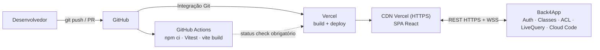
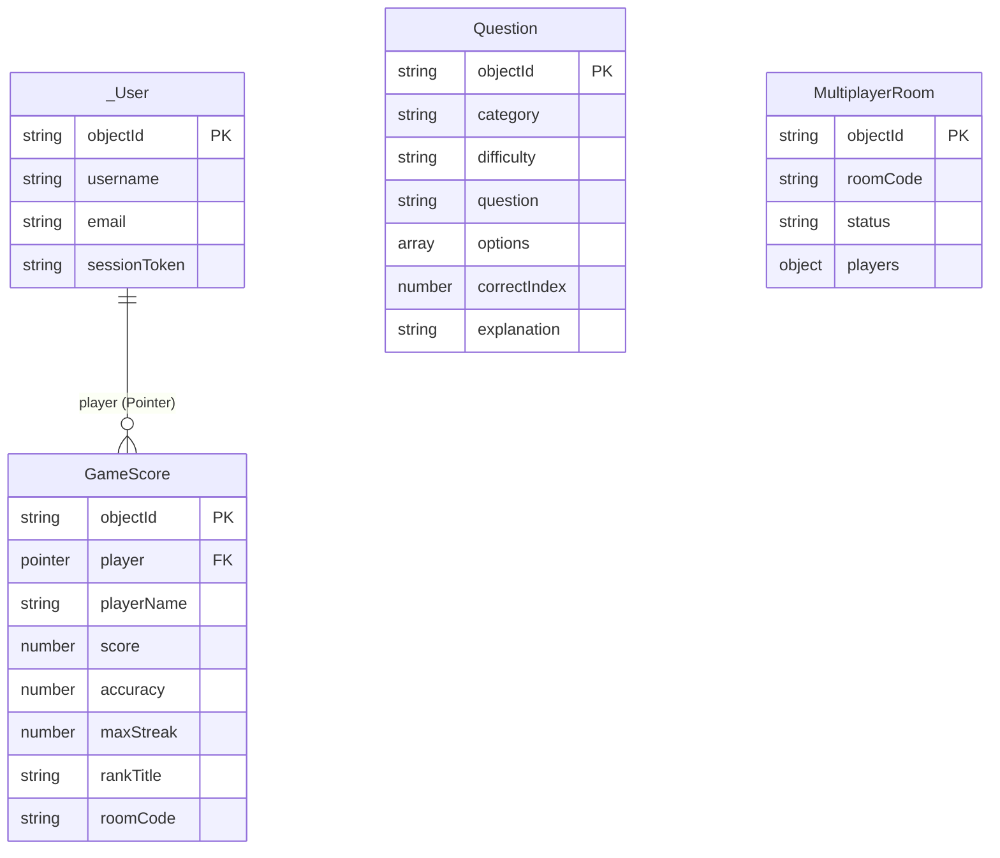

# UNIVERSIDADE DE FORTALEZA (UNIFOR)
## Centro de Ciências Tecnológicas — Ciência da Computação
### Disciplina: Desenvolvimento de Software em Nuvem

# Trabalho Final — **CloudQuiz Arena (Multiplayer Sincronizado)**
### Frontend na Vercel + Backend as a Service no Back4App

**Equipe (preencher):**
- Gerente de Projeto: `[Nome — Matrícula]`
- Desenvolvedor Frontend: `[Nome — Matrícula]`
- DevOps / Cloud: `[Nome — Matrícula]`
- Desenvolvedor Backend / BaaS: `[Nome — Matrícula]`

---

# PARTE I — ENTREGA 1: PLANO DE TRABALHO E ARQUITETURA

## 2.1. Introdução e Justificativa Tecnológica

O **CloudQuiz Arena** é um quiz web sobre Computação em Nuvem com **salas multiplayer sincronizadas** e **ranking global**. A arquitetura é 100% em nuvem e *serverless* do ponto de vista da equipe — não há servidor para administrar:

### 1. Backend as a Service — Back4App (Parse Platform)
O Back4App fornece autenticação, banco de dados, regras de segurança, tempo real e funções serverless prontas. Integramos **cinco recursos** (mínimo exigido: 4):
1. **Autenticação (`_User`)** — cadastro (`POST /users`), login (`POST /login`), logout e sessão via `X-Parse-Session-Token`.
2. **Banco de dados (Classes)** — `Question`, `GameScore` (com `Pointer` para `_User`) e `MultiplayerRoom`.
3. **Segurança (ACL + CLP)** — cada `GameScore` recebe `{"*":{"read":true}, "<userId>":{"read":true,"write":true}}`: todos leem o ranking, só o dono altera o próprio registro. A Master Key nunca é exposta ao cliente.
4. **Tempo real (LiveQuery)** — o progresso dos jogadores de uma sala (`MultiplayerRoom`) é propagado via WebSocket, com *polling* REST de 3 s como garantia.
5. **Cloud Code** — a função `validateAndSaveScore` valida no servidor o teto teórico de pontos (anti-cheat) antes de gravar.

### 2. Hospedagem do Frontend — Vercel (PaaS)
O frontend é uma SPA **React 18 + Vite**. A Vercel compila o projeto (`npm run build`) e distribui os estáticos em sua **CDN global (Edge Network)** com HTTPS automático. Escolhemos a Vercel porque:
- **Zero infraestrutura:** sem VM, sistema operacional, servidor web ou certificados para manter.
- **Integração nativa com GitHub:** `push` na `main` → deploy de produção; cada *Pull Request* → **Preview Deployment** com URL própria para revisão.
- **Rollback instantâneo** para qualquer deploy anterior pelo painel.
- **Variáveis de ambiente por ambiente** (Production / Preview / Development) para as chaves públicas do Back4App.

### 3. Qualidade com GitHub Actions
O workflow `.github/workflows/ci-cd.yml` roda a cada `push`/PR: instala dependências (`npm ci`), executa os **testes funcionais com Vitest** e valida o **build do Vite**. Com *branch protection* na `main`, só entra código aprovado — e só então a Vercel publica em produção.

---

## 2.2. Divisão de Papéis

| Papel | Responsável | Atribuições |
| :--- | :--- | :--- |
| **Gerente de Projeto** | `[Aluno 1]` | Kanban no GitHub Projects, cronograma das entregas, documentação e roteiro da apresentação. |
| **Desenvolvedor Frontend** | `[Aluno 2]` | Interface React/Vite (`src/App.jsx`, `src/styles.css`), regras do jogo (`src/utils/gameRules.js`) e testes Vitest. |
| **DevOps / Cloud** | `[Aluno 3]` | Projeto na Vercel, variáveis de ambiente, integração GitHub ↔ Vercel, workflow do GitHub Actions e *branch protection*. |
| **Backend / BaaS** | `[Aluno 4]` | Modelagem das classes no Back4App, CLPs/ACLs, Cloud Code (`cloud/main.js`), script de seed e LiveQuery. |

---

## 2.3. Tema e Escopo

- **Modelo:** CloudQuiz (Multiplayer Sincronizado).
- **Mecânica:** o jogador autenticado entra numa sala (ex.: `UNIFOR-01`) e responde questões com **20 s** cada. Os jogadores da mesma sala veem o placar uns dos outros ao vivo.
- **Pontuação por questão:**
  $$\text{Pontos} = \text{Base}_{\text{dificuldade}} + 5 \times \text{segundos restantes} + \text{Bônus de streak}$$
  Base: `easy` 100, `medium` 150, `hard` 200. Streak: +25 por acerto consecutivo a partir do 2º (máx. +125). Erro zera o streak.
- **Vitória:** solo — precisão ≥ 60% e ≥ 500 pts; multiplayer — maior pontuação da sala. Patentes: *Cloud Trainee* → *Junior Cloud Developer* → *Cloud Engineer* → *DevOps & SRE Lead* → *Principal Cloud Architect*.

---

## 2.4. Arquitetura, CI/CD e Versionamento

### Fluxo
```text
[Desenvolvedor] -> [GitHub Push/PR] -> [GitHub Actions (Testes + Build)]
                                    -> [Vercel (Build + Deploy Preview/Produção)] -> [Aplicação no Ar] <-> [Back4App (BaaS)]
```



### Branches
- **`main`** — produção. Protegida: merge só via PR com o check do GitHub Actions aprovado. Cada merge gera deploy de produção na Vercel.
- **`dev`** — integração. Cada push gera um **Preview Deployment** na Vercel.
- **`feature/*`** — uma por tarefa do Kanban; os PRs recebem URL de preview automática.

---

## 2.5. Requisitos e Modelagem

### Requisitos Funcionais
| ID | Requisito |
| :--- | :--- |
| RF01 | Cadastro, login e logout de jogadores pela classe `_User` do Back4App. |
| RF02 | Carregar as questões da classe `Question`. |
| RF03 | Cronômetro de 20 s e cálculo de pontos (base + tempo + streak). |
| RF04 | Salas multiplayer com placar sincronizado em tempo real (`MultiplayerRoom`). |
| RF05 | Salvar o resultado em `GameScore` com `Pointer` para o jogador e ACL, via Cloud Code. |
| RF06 | Ranking global e por sala ordenado por pontuação. |

### Requisitos Não-Funcionais
| ID | Requisito |
| :--- | :--- |
| RNF01 | Frontend servido pela CDN da Vercel com HTTPS automático. |
| RNF02 | Master Key do Back4App nunca exposta no frontend; escritas exigem session token; ACL/CLP em todas as classes. |
| RNF03 | Testes Vitest e build executados automaticamente a cada push/PR (< 2 min). |
| RNF04 | Deploy contínuo sem intervenção manual (produção na `main`, preview em PRs) e rollback em 1 clique. |
| RNF05 | Interface responsiva (desktop e mobile). |

### Modelo de Dados (Back4App)



| Classe | CLP | ACL |
| :--- | :--- | :--- |
| `_User` | padrão do Parse | dono escreve |
| `Question` | Public: Read | `{"*":{"read":true}}` — escrita só com Master Key (seed) |
| `GameScore` | Public: Read · Authenticated: Create | `{"*":{"read":true}, "<userId>":{"read":true,"write":true}}` |
| `MultiplayerRoom` | Public: Read · Authenticated: Create/Update | `{"*":{"read":true,"write":true}}` |

### Wireframes

```text
TELA 1 — LOGIN                         | RANKING            | TELEMETRIA BACK4APP
[ Login ] [ Criar conta ]              | 🥇 Ana   1320 pts  | 1. Auth  POST /login
Usuário [__________]                   | 🥈 Lucas 1090 pts  | 2. DB    GET /classes/GameScore
Senha   [__________]   [ Entrar ]      | 🥉 Mari   880 pts  |

TELA 2 — LOBBY
Código da sala [UNIFOR-01] [🚀 Iniciar partida]   [UNIFOR-01] [UNIFOR-02] [GLOBAL]
📡 Sala UNIFOR-01 em tempo real:  Gabriel • Q1 • 0 pts  |  Lucas • Q3 • 540 pts

TELA 3 — QUIZ
Tempo 16s | Pontos 245 | Streak 2x | MEDIUM
Pergunta... [A] [B ✅] [C] [D]
✅ Correto! +255 pts (150 base + 80 tempo + 25 streak)   [Próxima questão →]

TELA 4 — RESULTADO
🏆 Principal Cloud Architect — Score 1410 | 100% | 6/6 | streak 6x
Registro salvo no Back4App: { ..., "player": Pointer<_User>, "ACL": {...} }
```

---

# PARTE II — ENTREGA 2: RELATÓRIO TÉCNICO E DEPLOY

## 3.1. Back4App
1. Criar o app e copiar `Application ID`, `JavaScript Key` e `Master Key` (**App Settings → Security & Keys**).
2. `cp .env.example .env`, preencher e rodar `npm run seed` para criar as questões (Master Key usada só localmente).
3. **Cloud Code → Functions:** colar `cloud/main.js` e fazer **Deploy**.
4. Ajustar as CLPs conforme a tabela acima.
5. (Opcional) Ativar **LiveQuery** para `MultiplayerRoom` e `GameScore` e definir `VITE_BACK4APP_LIVEQUERY_URL`.

## 3.2. Vercel
1. **vercel.com/new** → importar o repositório do GitHub (preset **Vite** detectado; `vercel.json` incluso com *rewrite* de SPA).
2. **Settings → Environment Variables:** `VITE_BACK4APP_APP_ID`, `VITE_BACK4APP_JS_KEY`, `VITE_BACK4APP_SERVER_URL` e, opcionalmente, `VITE_BACK4APP_LIVEQUERY_URL`.
3. **Deploy.** Novos pushes na `main` publicam em produção automaticamente.

## 3.3. CI com GitHub Actions + Testes Funcionais
O job `test-and-build` executa `npm ci`, `npm test` e `npm run build`. Os 7 testes em `src/utils/__tests__/gameRules.test.js` validam:
- resposta errada zera pontos e streak;
- pontos base + bônus de tempo;
- acúmulo e teto do bônus de streak;
- regra de vitória no modo solo;
- vitória/derrota no multiplayer;
- payload do Back4App com `Pointer` e ACL;
- rejeição de payload sem `userId`/`username`.

Em **Settings → Branches** do GitHub, a regra de proteção da `main` exige o check `Vitest + Vite Build` antes do merge.

## 3.4. Roteiro da Apresentação ao Vivo
1. **Jogo + BaaS:** abrir a URL da Vercel em duas abas, logar com duas contas, entrar na sala `UNIFOR-01`, jogar e mostrar o placar sincronizado, o painel de telemetria e os registros nas classes do painel do Back4App.
2. **Alteração + pipeline:** criar uma branch, mudar o badge em `src/App.jsx` de `v1.0 • Vercel + Back4App` para `v2.0 • Ao vivo na UNIFOR`, abrir PR e mostrar o GitHub Actions rodando os testes e a Vercel gerando a URL de **preview**.
3. **Deploy em produção:** fazer o merge na `main`, mostrar o deploy no painel da Vercel e recarregar a URL de produção com o novo badge. (Extra: demonstrar **Instant Rollback**.)

## 4. Resumo das Ferramentas

| Camada | Ferramenta | Modelo | Uso |
| :--- | :--- | :--- | :--- |
| Hospedagem do frontend | **Vercel** | PaaS | Build, CDN global, HTTPS, previews e rollback |
| Backend | **Back4App** | BaaS | Auth, banco, ACL/CLP, LiveQuery, Cloud Code |
| Frontend | React 18 + Vite | — | Interface do jogo |
| CI | GitHub Actions | — | Testes + build a cada push/PR |
| Testes | Vitest | — | Regras de pontuação, vitória e segurança |
